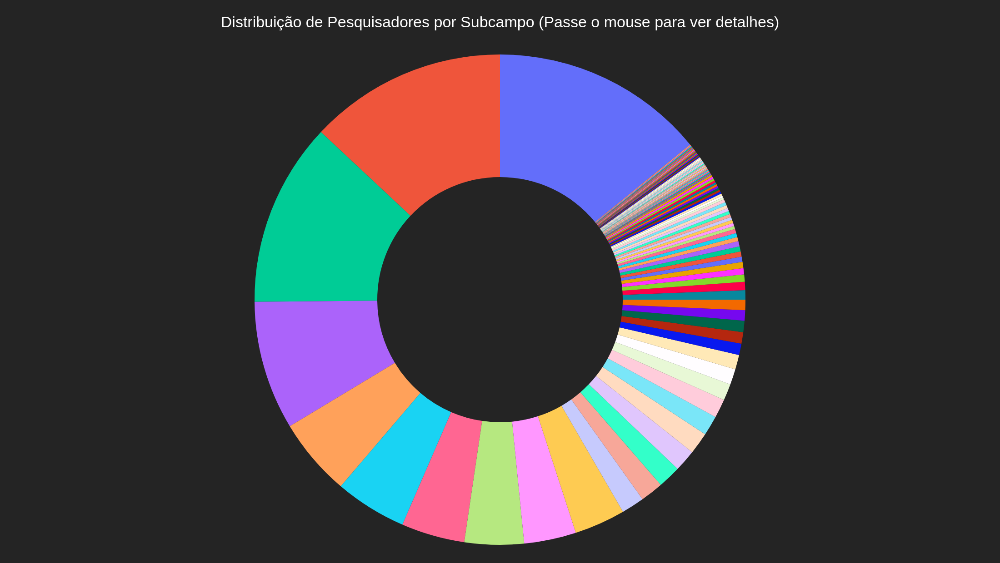
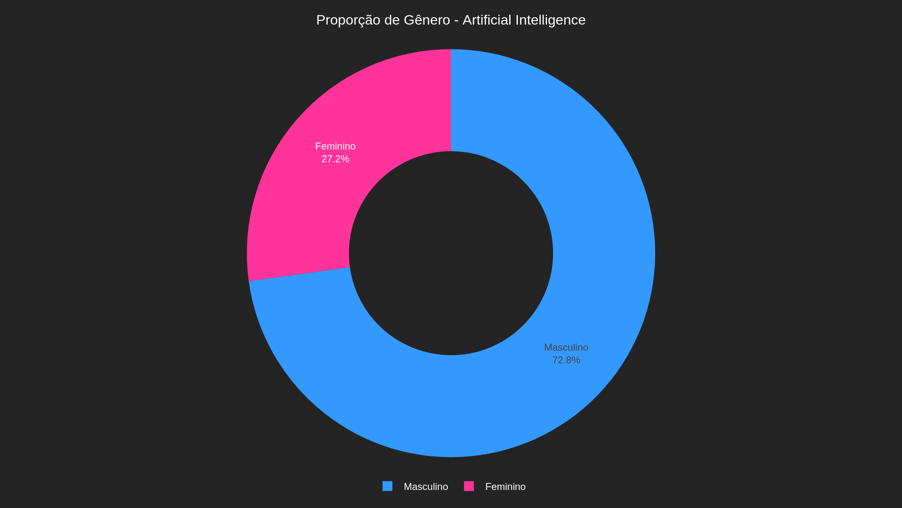

# 📊 Diversidade de Gênero na Pós-Graduação em Ciência da Computação

> *Dashboard interativo desenvolvido para visualização dos dados da pesquisa. O gráfico geral apresenta os valores absolutos (em branco) ao posicionar o cursor sobre cada subcampo.*

## 📖 Sobre o Projeto (Iniciação Científica)

Este estudo analisa a participação feminina em diferentes subcampos da Ciência da Computação em programas de pós-graduação no Brasil, especificamente da Universidade Federal de Ouro Preto. Para isso, foi utilizada uma base de dados pronta com informações desses pesquisadores. A partir do `author_id` contido nessa base, foram extraídos os principais tópicos de pesquisa de cada perfil diretamente da plataforma OpenAlex.

A metodologia consistiu no tratamento desses dados extraídos e na identificação do gênero dos pesquisadores, permitindo observar de forma interativa como as mulheres estão distribuídas entre as diferentes áreas de atuação da computação. 

**Principais Resultados:**
* A presença feminina varia significativamente entre os subcampos. 
* Em termos percentuais, há maior participação em áreas como **Interação Humano-Computador**. 
* Ao analisar os valores absolutos, observa-se que mesmo em áreas com maior número de pesquisadoras, como **Inteligência Artificial**, a participação feminina ainda é baixa quando comparada à masculina. 
* Em áreas mais técnicas, como *Hardware and Architecture* e *Computer Graphics and Computer-Aided Design*, a presença de mulheres é ainda menor. 

De modo geral, os dados indicam que a participação feminina na computação ocorre de forma desigual entre as áreas e tópicos de pesquisa.

## 🛠️ Tecnologias Utilizadas
* **Linguagem:** Python
* **Bibliotecas de Dados:** Pandas, OpenAlex API, NLTK
* **Visualização:** Plotly
* **Framework Web:** Dash (com Dash Bootstrap Components)

## Prévia

| Visão geral (todos os subcampos) | Um subcampo selecionado (exemplo: Artificial Intelligence) |
|---|---|
|  |  |
